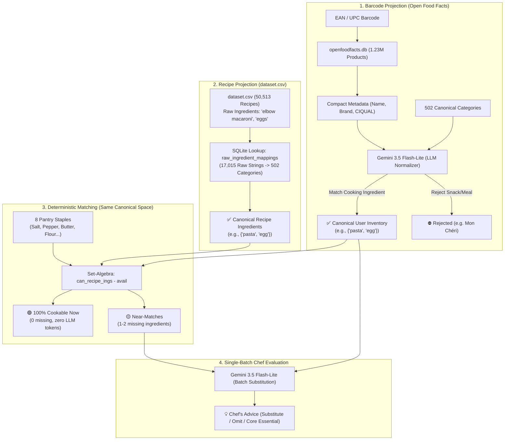

# Architecture & Methodology Documentation: Smart Barcode-to-Recipe Engine (Project ASE)

> **Purpose:** Comprehensive technical documentation of the ASE system—from raw datasets (`openfoodfacts.db`, `dataset.csv`) and the creation of the 502 canonical umbrella categories to deterministic recipe matching and LLM-powered substitution reasoning.

---

## 1. Executive Summary & Problem Formulation

The objective of Project ASE is to register physical grocery items via barcode scan (EAN/UPC), manage a canonical user pantry inventory, and match recipes in real time from a dataset of **50,513 recipes**.

### The Semantic Mismatch Challenge
A naive approach (raw string matching or basic text search) fails immediately due to a dual semantic mismatch:

1. **The Barcode Reality (Open Food Facts):**  
   Product descriptions are multilingual, noisy, and marketing-heavy (*"Mon Chéri"*, *"IMAT Oat Cream"*, *"Barilla Penne Rigate No. 73"*). Essential raw cooking ingredients often have no ingredient list at all.
2. **The Recipe Reality (50,513 Online Recipes):**  
   Recipe authors use idiosyncratic descriptions, preparation phrases, and quantities (*"freshly diced yellow onion"*, *"extra-virgin olive oil"*, *"3 large eggs, beaten"*).
3. **The Fragmentation Trap:**  
   A naive frequency list of individual ingredient strings splits pasta into 329 distinct shapes (*penne*, *fusilli*, *rotini*, *spaghetti*, *macaroni*) and sausages into 20 varieties. Essential staples like *penne* or *bratwurst* fall outside static Top-N catalogs and are rejected as "unknown."



---

## 2. Core Datasets & Infrastructure

| Component | Source / Format | Volume | Purpose |
| :--- | :--- | :--- | :--- |
| **`openfoodfacts.db`** | Local SQLite dump (Open Food Facts) | ~30 GB, 1.23M products | Barcode lookups for product name, brand, CIQUAL tags, and ingredient metadata |
| **`dataset.csv`** | Semicolon-delimited CSV | ~110 MB, 50,513 recipes | Recipe corpus with nutritional values (98.6% coverage), parsed ingredient dicts, and instructions |
| **`ingredients_normalized.db`** | SQLite (Intermediate pipeline) | 15,127 normalized ingredients | Cleaned singular ingredients without preparation adjectives for frequency audits |
| **`ingredients_canonical.db`** | SQLite (Production taxonomy) | 502 categories, 17,015 mappings | Relational Single Source of Truth for LLM prompting and $O(1)$ recipe matching |

---

## 3. Phase 1: Algorithmic Preprocessing of Recipe Ingredients

Before building the canonical taxonomy, raw ingredient strings from [`dataset.csv`](file:///home/felix/projects/ASE/dataset.csv) had to be stripped of culinary preparation noise and grammatically unified.

The script [`build_normalized_db.py`](file:///home/felix/projects/ASE/build_normalized_db.py) performs this step deterministically:

1. **Stripping Preparation Adjectives & Modifiers (`STRIP_PHRASES`):**  
   Over 60 regular expressions strip cuts, temperatures, processing states, and qualifiers:
   * *"finely chopped"*, *"diced"*, *"thinly sliced"*, *"crushed"*, *"melted"*, *"peeled"*, *"to taste"*, *"for frying"*, *"fresh"*.
   * Example: `freshly grated parmesan cheese` $\to$ `parmesan cheese`.
2. **Singularization with Guarded Exceptions (`inflect`):**  
   Plural forms are converted to singulars (`eggs` $\to$ `egg`, `onions` $\to$ `onion`).  
   A static protection set (`DO_NOT_SINGULARIZE`) prevents damage to culinary terms that are pluralia tantum or uncountable (e.g., `asparagus`, `couscous`, `hummus`, `molasses`, `swiss cheese`).
3. **Output in [`ingredients_normalized.db`](file:///home/felix/projects/ASE/ingredients_normalized.db):**
   * Table `normalized_frequencies`: 15,127 aggregated singular ingredient strings with their total recipe frequencies.
   * Table `ingredient_mappings`: Exact 1:1 lookup mapping 17,015 raw recipe strings to their normalized singular equivalent.

---

## 4. Phase 2: Canonical Taxonomy Construction (The 502 Umbrella Categories)

How do 15,127 idiosyncratic strings become a clean, disjoint controlled vocabulary for an LLM?

### Methodology
Pure string clustering or vector embeddings fail at culinary chemistry (see [Section 7](#7-why-vector-embeddings-fail-at-culinary-logic)). The taxonomy was constructed through **culinary auditing of the Top 1,000 recipe ingredients** from [`ingredients_normalized.db`](file:///home/felix/projects/ASE/ingredients_normalized.db):

1. **Empirical Coverage Base:**  
   The Top 1,000 ingredients in `normalized_frequencies` account for over **88% of all ingredient occurrences** across the entire 50,000-recipe dataset.
2. **Three Core Consolidation Rules:**
   * **Rule A (Consolidate Shapes & Cut Variations):**  
     All 26 distinct pasta cuts (*spaghetti*, *penne*, *fusilli*, *macaroni*, *rotini*) collapse into **`pasta`**.  
     All common onion types (*yellow onion*, *white onion*, *red onion*) collapse into **`onion`**.  
     All dairy cream variants (*heavy whipping cream*, *double cream*) collapse into **`heavy cream`**.  
     International specialties are classified into their culinary equivalents (*kielbasa* $\to$ `sausage`, *plantain* $\to$ `banana`, *tamari* $\to$ `soy sauce`).
   * **Rule B (Strictly Preserve Culinary & Chemical Boundaries):**  
     Ingredients with distinct chemical leavening, acid, or flavoring functions are **strictly kept disjoint**:  
     `baking powder` $\neq$ `baking soda` $\neq$ `yeast`.  
     `apple cider vinegar` $\neq$ `balsamic vinegar` $\neq$ `white vinegar`.  
     `garlic powder` $\neq$ `garlic salt`.
   * **Rule C (Eliminate Non-Food & Packaging Artifacts):**  
     Recipe scraping artifacts (*aluminum foil*, *toothpick*, *plastic wrap*, *for frying*, *water to cover*) were compiled into a permanent exclusion set (`NON_FOOD`).

### Database Implementation & Relational Integrity
The mappings were defined and materialized via [`build_canonical_database.py`](file:///home/felix/projects/ASE/build_canonical_database.py):

```
ingredients_canonical.db
├── canonical_categories (502 rows)
│   ├── category_name [PK]
│   ├── is_staple (1 for salt, water, butter, pepper, sugar, oils, flour)
│   ├── recipe_count
│   ├── mapped_variants_count
│   └── sample_variants
│
├── ingredient_mappings (15,127 rows)
│   ├── normalized_ingredient [PK]
│   ├── canonical_category [FK -> canonical_categories.category_name]
│   ├── recipe_count
│   └── is_mapped (1 = mapped [1,177], 0 = rare long-tail [13,950])
│
└── raw_ingredient_mappings (17,015 rows)
    ├── raw_ingredient [PK]
    └── canonical_category
```

> [!TIP]
> **Coverage:** The 502 canonical categories deterministically cover **89.39%** (413,890 out of 463,019 recipe ingredient occurrences) in the entire dataset.

---

## 5. Phase 3: Runtime Barcode Classification with Structured LLM

When a user scans a barcode, the item is classified into the taxonomy using [`prototype_optimal.py`](file:///home/felix/projects/ASE/prototype_optimal.py):

1. **Metadata Condensation:**  
   Out of 150–200 raw JSON attributes in `openfoodfacts.db`, `extract_compact_metadata()` filters down to the culinarily relevant fields: `product_name`, `generic_name`, `brands`, `categories`, `ingredients_text`, `ciqual_food_name`.
2. **Structured Pydantic Inference:**  
   The LLM (`gemini-3.5-flash-lite`) receives the condensed product metadata alongside the 502 allowed categories. It responds using a strict Pydantic schema:
   ```python
   class CategoryMatchResult(BaseModel):
       is_match: bool
       matched_category: Optional[str]  # Exact string from the 502 categories
       confidence: float
       explanation: str
   ```
3. **Rejection of Non-Cooking Items:**  
   Confectionery, snacks (*"Mon Chéri"*, *"Pringles"*), candy, and ready-made meals are rejected (`is_match: false`). Only core cooking ingredients enter the `user_inventory`.
4. **Parallel Execution:**  
   Using a `ThreadPoolExecutor` with 10 workers, 50 scanned grocery items are classified in parallel in **under 6 seconds**.

---

## 6. Phase 4: Deterministic Recipe Matching & Chef Evaluation

Once `user_inventory` contains recognized canonical ingredients, recipe evaluation proceeds in two stages:

### Stage 1: 100% Deterministic Set-Algebra (Zero LLM Tokens)
For every recipe in [`dataset.csv`](file:///home/felix/projects/ASE/dataset.csv):
* Raw ingredients are converted into canonical categories via the precomputed SQLite index `raw_ingredient_mappings`.
* Required items are matched against `user_inventory` plus 8 assumed pantry staples (salt, black pepper, water, sugar, butter, olive oil, vegetable oil, flour).
* **Categorization:**
  * 🟢 **100% Matches (Cookable Now):** All required ingredients are in stock or staples. Zero LLM involvement.
  * 🟡 **Near-Matches (Almost Cookable):** Missing exactly 1–2 ingredients, ranked by match percentage.
  * **Strict Disjointness:** A recipe in the 100% list is strictly excluded from near-matches.

### Stage 2: Single-Batch LLM Substitution Reasoning
Rather than firing separate LLM calls for each candidate dish, all top near-matches are bundled into **a single structured LLM call**:

```python
class RecipeSubstitutionItem(BaseModel):
    recipe_index: int
    title: str
    can_omit: bool                      # Can the missing ingredient be safely omitted?
    can_substitute_from_inventory: bool # Can an item from pantry inventory substitute it?
    substitute_ingredient: Optional[str]
    is_essential: bool                  # Is it an indispensable core component? (e.g. potatoes in mashed potatoes)
    advice: str                         # Concise 1-2 sentence culinary guidance
```

---

## 7. Why Vector Embeddings Fail at Culinary Logic

During prototyping, vector embeddings (e.g., cosine similarity over dense text embeddings) were evaluated and rejected:

```
Embedding Space (Cosine Similarity)
┌────────────────────────────────────────────────────────┐
│  "baking soda" <─── 0.94 Similarity ───> "baking powder" │  💥 Leavening failure
│  "garlic salt" <─── 0.91 Similarity ───> "garlic powder" │  💥 Ruined by over-salting
│  "balsamic"    <─── 0.88 Similarity ───> "apple cider"   │  💥 Discolored sauce
└────────────────────────────────────────────────────────┘
```

1. **Semantic Proximity $\neq$ Culinary Interchangeability:**  
   Embeddings capture linguistic context. Because *baking soda* and *baking powder* appear in identical syntactic patterns, they are close neighbors in vector space. In culinary reality, replacing one with the other destroys the dish.
2. **Canonical Categories Provide Exact Control:**  
   The 502 categories enforce clean separation of chemically distinct ingredients while unifying true culinary synonyms (*penne*, *fusilli* $\to$ `pasta`).

---

## 8. Performance, Latency & Cost Economics

The system is optimized for sub-cent production economics:

| Pipeline Step | Technology | Latency | Tokens / Cost |
| :--- | :--- | :--- | :--- |
| **Barcode Lookup** | SQLite (indexed `barcode`) | < 1 ms | $0.00 |
| **50 Barcodes Classified** | Gemini Flash-Lite (10 parallel workers) | ~5.5 s | ~17,500 Tokens (~$0.0013 USD) |
| **Recipe Matching (50,513 recipes)** | SQLite Hashmap / Set-Intersection | ~450 ms | $0.00 (0 Tokens) |
| **Substitution Reasoning (Near-Matches)** | Gemini Flash-Lite (Single-Batch Call) | ~1.2 s | ~1,200 Tokens (~$0.0002 USD) |
| **Full End-to-End Run** | **Hybrid Pipeline** | **~7.1 s** | **<$0.002 USD** |

---

## 9. File Matrix

```
/home/felix/projects/ASE
├── openfoodfacts.db                 # 30 GB raw Open Food Facts dump (1.23M products)
├── dataset.csv                      # 50,513 structured recipes with nutrition
├── build_normalized_db.py           # Phase 1: Regex & inflect singularization script
├── ingredients_normalized.db        # Phase 1: 15,127 normalized ingredient singulars
├── build_canonical_database.py      # Phase 2: Builds 502-category taxonomy DB
├── canonical_categories.csv         # Phase 2 Export: CSV table of 502 categories
├── canonical_taxonomy_map.json      # Phase 2 Export: JSON master taxonomy map
├── ingredients_canonical.db         # Phase 2: Production taxonomy SQLite database
├── prototype_optimal.py             # Phase 3 & 4: Production prototype (scan, match, chef eval)
├── README.md                        # Quickstart guide & repo overview
├── DOCUMENTATION.md                 # Full end-to-end architecture & methodology guide
└── agent.md                         # Context & operational guide for AI coding assistants
```
